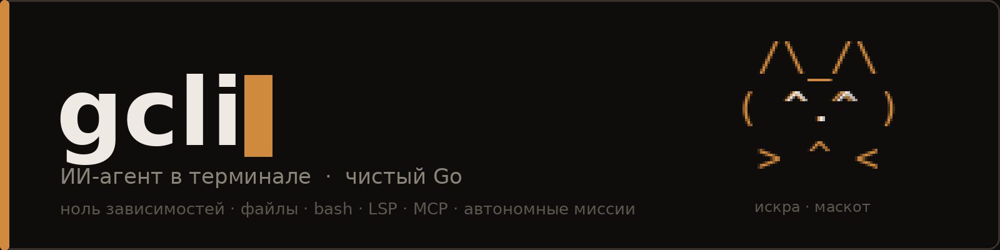
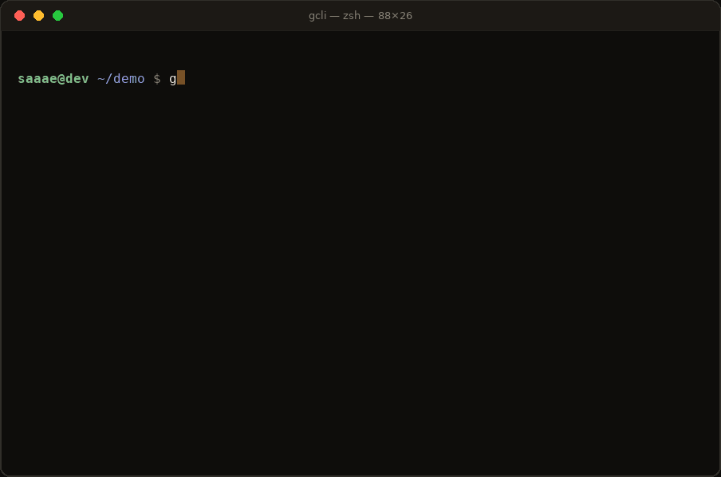
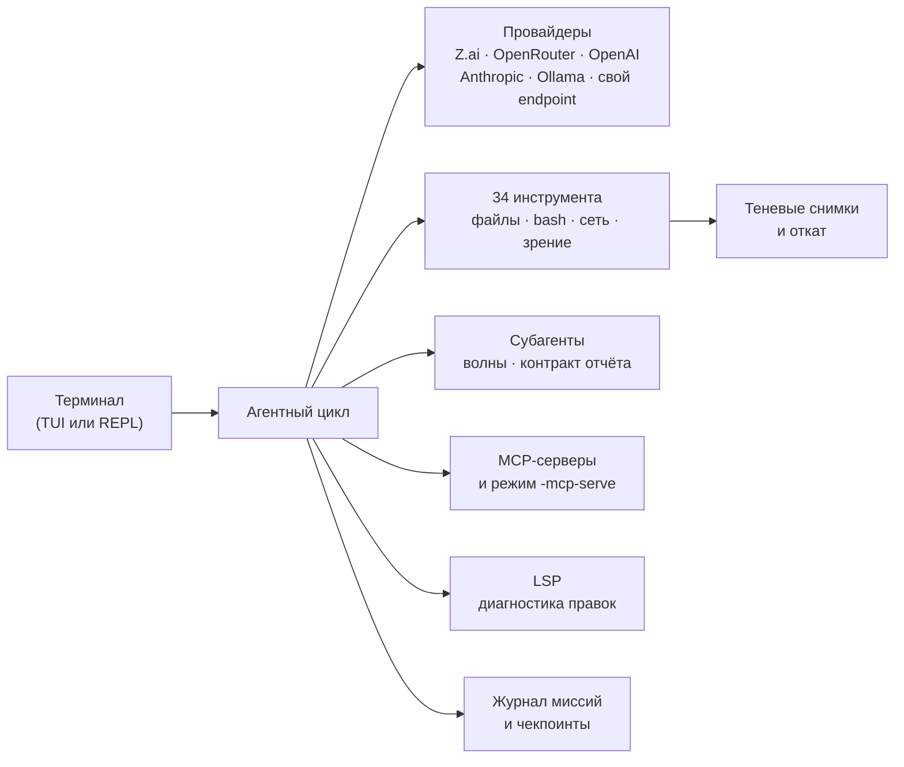

<div align="center">



[](https://github.com/saaae1337/gCLI/actions/workflows/ci.yml)
[](src/go.mod)
[](LICENSE)
[](https://github.com/saaae1337/gCLI/releases/latest)
[](https://github.com/saaae1337/gCLI/issues/new?template=bug_report.md)

**gcli** («Джикли») — ИИ-агент в терминале: читает проект, пишет код,
запускает команды, ведёт сессию. Один бинарник на чистом Go —
**ноль внешних зависимостей** в `go.mod`, настройки в `~/.gcli`.



*Живая сессия gcli. Кот справа от поля ввода — **Искра**, маскот проекта:
встречает, слушает, думает вместе с агентом, мурчит от результата и
засыпает, пока вы не пишете.*

</div>

## Зачем ещё один агент

- **34 инструмента** — файлы, поиск, сборка, сеть, фоновые процессы,
  задачи и контроль над самим агентом;
- **автономный прогон на часы** — срок, потолок токенов и денег, критерии
  приёмки, журнал событий, переживание обрыва процесса;
- **цепочки миссий** — большая цель дробится на шаги, итог шага уходит в
  промпт следующего, прогресс переживает перезапуск;
- **субагенты** — параллельные волны, контракт отчёта, заземление выводов
  на реально прочитанных файлах;
- **LSP-диагностика** после каждой правки — агент видит сломанный тип
  сразу, не дожидаясь прогона сборки;
- **теневые снимки** проекта на каждый ход и откат к любому из них;
- **сервер и MCP** — gcli слушает HTTP+SSE и отдаёт себя другим агентам
  как MCP-сервер по stdio;
- **Искра** — живой маскот с 19 состояниями: агент всегда показывает,
  что он сейчас делает.

## Содержание

- [Установка](#установка)
- [Быстрый старт](#быстрый-старт)
- [Искра — маскот](#искра--маскот)
- [Как это устроено](#как-это-устроено)
- [Команды REPL](#команды-repl)
- [Инструменты агента](#инструменты-агента)
- [Автономный прогон и cron](#автономный-прогон-и-cron)
- [Провайдеры и модели](#провайдеры-и-модели)
- [Расширяемость](#расширяемость)
- [Безопасность](#безопасность)
- [Документация и сообщество](#документация-и-сообщество)
- [Лицензия](#лицензия)

## Установка

Готовые бинарники — в разделе
[Releases](https://github.com/saaae1337/gCLI/releases): Linux, macOS и
Windows (amd64 и arm64). Рядом лежит `SHA256SUMS.txt` — сверьте файл
перед запуском:

```bash
sha256sum -c SHA256SUMS.txt      # Linux
shasum -a 256 -c SHA256SUMS.txt  # macOS
```

Скачайте нужный файл, положите в `PATH` (Linux/macOS — `chmod +x`),
и всё. Проверка:

```bash
gcli -v
```

Из исходников — Go 1.21 или новее, зависимостей нет:

```bash
git clone https://github.com/saaae1337/gCLI.git
cd gCLI && ./build.sh one linux amd64   # только своя платформа
# или ./build.sh — сразу все шесть платформ, в builds/
```

Каталог после клона — ровно `gCLI`: на Linux и macOS регистр значим,
`cd gcli` не найдёт.

## Быстрый старт

```bash
gcli -setup        # мастер: провайдер → ключ → модель
gcli               # полноэкранный TUI
gcli -p "текст"    # один запрос и выход — для скриптов и CI
gcli -plain        # построчный REPL, если полноэкранный не нужен
```

Ключ можно не вводить в мастере — достаточно переменной окружения
(`ZAI_API_KEY`, `OPENROUTER_API_KEY`, `OPENAI_API_KEY`,
`ANTHROPIC_API_KEY` — см. [Провайдеры](#провайдеры-и-модели)).

Полезные флаги на каждый день:

| Флаг | Что делает |
|------|------------|
| `-c` | продолжить последнюю сессию |
| `-r <номер>` | возобновить сессию №N (список — `/sessions`) |
| `-watch <команда>` | слежение за файлами: проверка упала — агент чинит |
| `-autopilot on` | сам одобряет безопасные действия |
| `-snapshots on` | теневые снимки на каждый ход (откат — `/revert`) |

Полный список флагов — `gcli -help` или
[docs/reference.md](docs/reference.md#флаги).

## Искра — маскот

Искра — рыжая кошка gcli. Живёт в колонке слева от поля ввода и на
заставке, меняет позу вместе с агентом и показывает состояние хода:

```text
  /\_/\      ждёт команду      ( ^.^ )
 ( ^.^ )     думает            ( -.- )
  > ^ <      работает          ( >.< )
             радуется          ( ^ω^ )
             фыркает           ( x_x )
             спит              ( -.- ) zZ
```

Всего 19 состояний — от подмигивания до обиды. Пока вы не печатаете,
Искра моргает, потом скучает и засыпает; при успехе мурчит, при ошибке
фыркает, а после двух ошибок подряд ворчит «опять?!».

```bash
/mascot demo      # все состояния подряд
/mascot say мяу   # реплика от кота
/mascot off       # выключить (или GCLI_MASCOT=0)
```

Галерея всех состояний — [docs/mascot.md](docs/mascot.md).

## Как это устроено



Один бинарник, один пакет интерфейса (`src/tui`), собственный рендерер
без внешних библиотек: лента диалога, поле ввода с переносами, модальные
окна подтверждений, палитра команд. При выходе терминал возвращает
прежнее содержимое. Подробности — в
[docs/reference.md](docs/reference.md#свой-интерфейс).

## Команды REPL

Все команды — с автодополнением по Tab и палитрой. Основное:

| Команда | Действие |
|---------|----------|
| `/help` | справка по командам |
| `/setup` | мастер настройки провайдера, ключа и модели |
| `/model`, `/models` | смена модели, список доступных |
| `/agent on\|off` | агентный режим |
| `/autopilot`, `/yolo` | автопилот подтверждений |
| `/plan` | режим планирования: сначала план — потом действия |
| `/mascot` | Искра: `on`, `off`, `demo`, `say`, `wave` |
| `/mission` | автономный прогон: `start long-time 4h 1m «цель»` |
| `/cron on\|off` | автономные итерации при тишине 15–20 мин |
| `/mcp` | MCP-серверы, перезагрузка конфигурации |
| `/skills`, `/agents` | навыки и свои субагенты |
| `/context`, `/usage`, `/stats` | контекст, токены, расходы |
| `/undo`, `/revert`, `/snapshots` | чекпоинты и теневые снимки |
| `/compact` | сжать историю, когда контекст подбирается к потолку |
| `/export`, `/copy` | выгрузка сессии |
| `/sessions`, `/resume`, `/fork` | сессии: список, продолжение, вилка |
| `/doctor` | диагностика окружения |
| `/clear`, `/quit` | очистка экрана, выход |

Полный справочник команд — в
[docs/reference.md](docs/reference.md#команды-repl).

## Инструменты агента

34 инструмента сгруппированы по назначению; полный список с описаниями —
в [docs/reference.md](docs/reference.md#инструменты-агента).

- **Чтение и запись** — `read_file`, `write_file`, `edit_file`, `glob`,
  `grep`, `outline`, кодировка определяется автоматически;
- **выполнение и сеть** — `bash`, `multi_bash`, фоновые процессы,
  `web_search`, `web_fetch` c защитой от SSRF;
- **проверка и контроль** — `verify` (сборка/тесты), `git diff`,
  `think`, `remember`, `tasks`;
- **субагенты** — делегирование волнами, контракт отчёта, заземление
  выводов на прочитанных файлах;
- **зрение** — `screenshot`, `read_image`: снимок страницы или картинка
  в контекст (нужен headless-браузер, путь — `GCLI_BROWSER`);
- **пакетные вызовы** — `multi_edit` и другие пакетные формы, чтобы
  не гонять инструменты по одному.

## Автономный прогон и cron

Миссия — это работа без новых промптов: агент сам идёт к цели по
критериям приёмки, пока не кончатся срок, токены или бюджет.

```bash
gcli -mission long-time -deadline 4h -budget 500k,25 \
     -objective "доведи тесты пакета tools до зелёных"
```

- режимы `long-time`, `extra-long-time`, `overnight` или свой
  `mission.json`;
- `deadline` — 4h, 90m или число минут; `budget` — токены и деньги;
- журнал событий переживает обрыв процесса — прогон можно продолжить;
- `-cron on` — автономные итерации: в паузах 15–20 минут агент сам
  ищет и чинит баги, проблемы и уязвимости по очереди приоритетов.

Отчёт по прогону — сессией в gcli или HTML-выгрузкой. Подробности —
[docs/reference.md](docs/reference.md#автономный-прогон).

## Провайдеры и модели

Провайдер — один флаг, ключ — одна переменная:

| Провайдер | Переменная | Модели |
|-----------|-----------|--------|
| Z.ai (GLM) | `ZAI_API_KEY` | `glm-4.6` и другие GLM |
| OpenRouter | `OPENROUTER_API_KEY` | 300+ моделей одним ключом |
| OpenAI и совместимые | `OPENAI_API_KEY` | `gpt-4o`, свой `OPENAI_BASE_URL` |
| Anthropic | `ANTHROPIC_API_KEY` | Claude, свой `ANTHROPIC_BASE_URL` |
| Ollama | — | локальные модели, без ключа |
| Любой другой | `/provider add` | свой endpoint по OpenAI/Anthropic-протоколу |

`DEEPSEEK_API_KEY`, `GROQ_API_KEY`, `MISTRAL_API_KEY`, `XAI_API_KEY`,
`TOGETHER_API_KEY` тоже работают. Пул ключей с ротацией — в
[docs/reference.md](docs/reference.md#провайдеры-и-модели).

## Расширяемость

- **Навыки** — `~/.gcli/skills/*.md` и `./.gcli/skills/*.md`: markdown
  с front matter, автоподбор по задаче, дистилляция опыта прогона в
  новый навык;
- **свои субагенты** — `~/.gcli/agents/*.md`: роль, инструменты, модель;
- **расширения** — `~/.gcli/extensions/*.json`: свои инструменты без
  правки кода;
- **MCP** — `~/.gcli/mcp.json`: внешние серверы инструментов; и наоборот,
  `gcli -mcp-serve` превращает сам gcli в MCP-сервер для других агентов;
- **память** — `remember` и `/memory`: агент помнит решения между
  сессиями.

Примеры — в [examples/](examples/): навыки, расширения, команды.

## Безопасность

- подтверждения на запись файлов и команды: модальные окна, а не
  «Y/N» в общем потоке; автопилот одобряет только безопасное,
  `-yolo` — всё, кроме заведомо опасных команд;
- `cmdguard` — разбор команды перед запуском: опасные конструкции
  видны до нажатия Enter;
- SSRF-защита у сетевых инструментов, редакция секретов (`redact`)
  в логах и выгрузках;
- теневые снимки на каждый ход: `/revert` откатывает файлы целиком,
  `snapshots off` — если проектов слишком много;
- песочница запуска (`/sandbox`) и разрешения (`/permissions`).

Подробности и чужие файлы не в UTF-8 — в
[docs/reference.md](docs/reference.md#безопасность).

## Документация и сообщество

| Документ | О чём |
|----------|-------|
| [docs/reference.md](docs/reference.md) | полный справочник: флаги, команды, инструменты, конфигурация, переменные окружения |
| [docs/mascot.md](docs/mascot.md) | галерея всех состояний Искры |
| [CHANGELOG.md](CHANGELOG.md) | история изменений |
| [CONTRIBUTING.md](CONTRIBUTING.md) | как собирать, тестировать и вносить изменения |
| [examples/](examples/) | примеры навыков, расширений и команд |
| [SUPPORT.md](SUPPORT.md) | куда писать с вопросами |
| [SECURITY.md](SECURITY.md) | как сообщить об уязвимости |
| [CODE_OF_CONDUCT.md](CODE_OF_CONDUCT.md) | правила общения |

## Лицензия

[MIT](LICENSE). И Искра — свободная кошка: её кадры и реплики — часть
проекта под той же лицензией.
